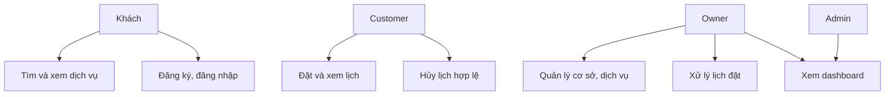
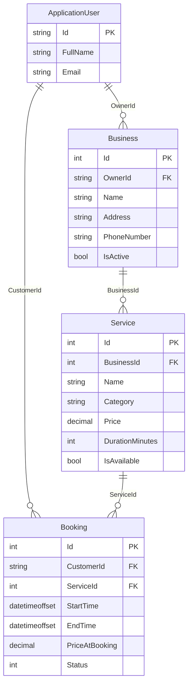
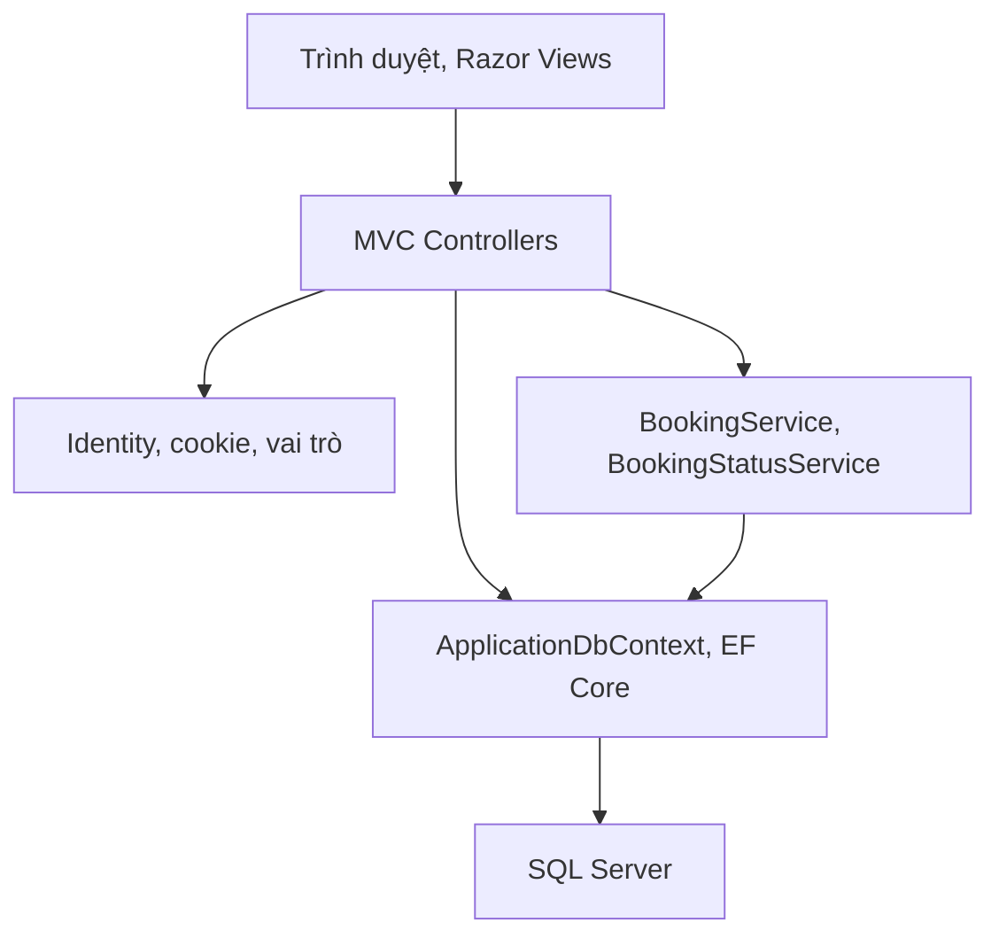

# S3-06 — Ca sử dụng, dữ liệu và kiến trúc theo `main`

Đối chiếu mã tại `ea2e9237c56a161c3b451d57598d8a998d23885e` (24/11/2026). Đây là sơ đồ của **mã hiện có**, chưa phải bằng chứng kiểm thử tích hợp. Sau khi nhóm merge thêm PR, cần kiểm tra và cập nhật sơ đồ theo commit mới.

## Ca sử dụng

| Vai trò | Ca sử dụng | Mã liên quan |
| --- | --- | --- |
| Khách chưa đăng nhập | Xem/tìm/lọc dịch vụ, đăng ký và đăng nhập | `ServicesController`, `AccountController` |
| Customer | Xem hồ sơ, đặt lịch, xem lịch của mình, hủy theo trạng thái | `AccountController`, `ServicesController.Book`, `BookingsController` |
| Owner | Quản lý cơ sở, dịch vụ, xem và xử lý lịch của cơ sở mình, xem dashboard | `BusinessesController`, `OwnerServicesController`, `BookingsController`, `DashboardController` |
| Admin | Xem dashboard tổng hệ thống, xem hồ sơ của mình | `DashboardController`, `AccountController` |

Tên vai trò là role của ASP.NET Core Identity. Phân quyền được khai báo trong controller, đồng thời các truy vấn theo chủ sở hữu lọc bằng ID người dùng; không suy diễn rằng Admin có quyền sửa mọi cơ sở/dịch vụ. Ca “xóa” cơ sở hoặc dịch vụ có thể bị chặn khi đã có dữ liệu liên quan; xem controller trước khi thuyết minh.

## ERD nghiệp vụ

Các trường `Description`, `CreatedAt` và trường Identity chuẩn khác không vẽ hết để sơ đồ dễ đọc. `ApplicationUser` kế thừa `IdentityUser`; các bảng `AspNetRoles`, `AspNetUserRoles` và bảng Identity khác do `IdentityDbContext<ApplicationUser>` tạo. Quan hệ trong sơ đồ dựa trên `Data/ApplicationDbContext.cs`; các FK tới Owner, Customer, Business và Service được đặt `DeleteBehavior.Restrict`. Trạng thái lịch trong `Models/BookingStatus.cs`: Pending = 0, Confirmed = 1, Cancelled = 2, Rejected = 3, Completed = 4.

## Kiến trúc và luồng

`Program.cs` nạp cấu hình Development riêng, đăng ký MVC/Identity/EF Core, middleware xác thực và route `{controller=Home}/{action=Index}/{id?}`. Khi chạy Development, `DevelopmentBootstrapper` áp dụng migration và seed theo cấu hình, chi tiết xem [DEV_SETUP.md](DEV_SETUP.md). Thao tác đặt lịch ở MVC đi qua `BookingService` để kiểm tra giá, thời lượng, khung giờ và xung đột. Giao diện chỉ là một lớp của hệ thống; cần kiểm thử thực tế trên SQL Server để kết luận chống trùng đồng thời.

`main` ở commit này **chưa có API JSON** dù mô tả kế hoạch README có nhắc REST API. Xem [S3-06_API_STATUS.md](S3-06_API_STATUS.md) trước khi bổ sung API vào sơ đồ hoặc slide.
